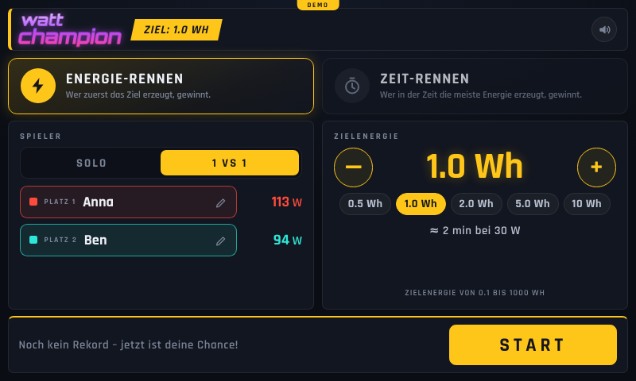

# watt champion – Rennoberfläche für den Raspberry Pi

Spieler erzeugen Strom (Handkurbel, Fahrrad-Generator …) und treten gegeneinander oder gegen den
Rekord an. Die Oberfläche zeigt live Leistung (W), Gesamtenergie (mWh), Fortschritt, eine
Rennstrecke mit Autos, die Leistungskurve, Rennzeit und Rekord.

| Einstellung | Rennen läuft | Ziel erreicht |
| --- | --- | --- |
|  |  |  |

## Spielmodi

| | Energie-Rennen | Zeit-Rennen |
| --- | --- | --- |
| **Ziel** | 0,1 bis 1000 Wh | 5 bis 3600 s Zeitlimit |
| **Gewinner** | wer zuerst das Ziel erzeugt | wer nach Ablauf der Zeit die meiste Energie hat |
| **Rekord** | schnellste Zeit | meiste Energie |
| **1 vs 1** | zwei Autos, „Führt!“, „Gleichauf!“, … | dazu bei Gleichstand „Unentschieden“ |
| **Solo** | gegen die Uhr, der bisherige Rekord fährt als grauer **Geist** mit | wie 1 vs 1, die Strecke zeigt den Fortschritt zum Rekord |

Rekorde gelten je Modus **und** Ziel (eine andere Zielenergie ist eine andere Wertung). Im
Zeit-Rennen läuft die Strecke gegen den Rekord, solange es noch keinen gibt, gegen einen Richtwert
(`time_reference_w`); wer ihn übertrifft, fährt über 100 %.

Weitere Funktionen: Countdown (3-2-1-LOS!), Ergebnis-Dialog mit Sieger, Spitzen- und
Durchschnittsleistung, Vergleichswerte (Handy-Akku, LED-Lampe, Laptop), Konfetti, Töne (abschaltbar),
Namen per **Bildschirmtastatur** und „Abbrechen“ nur durch Gedrückthalten.

## Schnellstart

**Ohne Server, nur Chrome (Demo):** `static/index.html` im Browser öffnen, Doppelklick genügt. Die
Oberfläche rechnet dann mit einer eingebauten Simulation (oben steht „Demo“). Mit `?speed=4` an der
Adresse laufen die simulierten Spieler schneller (`index.html?speed=4`), das ist praktisch zum
Ausprobieren. Auch ein statisches Hosting ohne Server fällt automatisch in diesen Modus.

**Mit Server** (Rennlogik, Rekorde und Sensoren laufen dann auf dem Pi; nur die Python-Standardbibliothek,
Python ≥ 3.9):

```bash
cd watt-champion
python3 server.py
```

Dann `http://127.0.0.1:8080/` öffnen. Standardmäßig läuft eine **Simulation** (Reiter „Simulation“).
Alle Schriften liegen lokal, der Pi braucht kein Internet.

**Bedienung:** Modus, Spielerzahl, Namen (Name antippen) und Ziel wählen (`+`/`−` oder Schnellwahl,
gedrückt halten wiederholt), dann *Start*. Beim Ergebnis: *Nochmal* oder *Neue Challenge*.
Tastatur: `Leertaste`/`Enter` Start bzw. Nochmal, `Esc` im Ergebnis zur Einstellung, `R` zurücksetzen,
`M` Ton, `F` Vollbild.

## Konfiguration (`config.json`)

| Schlüssel | Bedeutung | Standard |
| --- | --- | --- |
| `title` | Logo-Text (erstes Wort oben, Rest darunter) | `watt champion` |
| `host`, `port` | Adresse des Servers. `127.0.0.1` = nur der Pi selbst; `0.0.0.0` = im Netzwerk erreichbar | `127.0.0.1`, `8080` |
| `mode`, `solo` | Vorauswahl nach dem Start: `energy`/`time`, Solo ja/nein | `energy`, `false` |
| `target_wh` | Vorgabe Zielenergie in Wh (0,1 bis 1000) | `1.0` |
| `time_goal_s` | Vorgabe Zeitlimit in Sekunden (5 bis 3600) | `60` |
| `time_reference_w` | Richtwert in W für die Strecke im Zeit-Rennen ohne Rekord | `30` |
| `countdown_s` | Countdown vor dem Start in Sekunden (`0` = sofort) | `3` |
| `tie_threshold_pct` | Liegen die Spieler weniger als so viele Prozent der Bezugsenergie auseinander, steht „Gleichauf!“ | `10` |
| `sample_hz` | Messungen pro Sekunde | `10` |
| `results_file` | Rekordliste (JSON), relativ zur Konfigurationsdatei; `null` = nicht speichern | `data/results.json` |
| `sponsor_logo` | Bild oben rechts, z. B. `"img/sponsoren.png"` (Datei in `static/img/` ablegen) | – |
| `sensor` | Messwertquelle, siehe unten | `{"type": "sim"}` |
| `players` | genau 2 Plätze: `id`, `name`, `color` (`red`, `cyan`, `green`, `magenta`, `orange`, `blue`) | Anna (rot), Ben (cyan) |

Modus, Ziel, Spielerzahl und Namen lassen sich zusätzlich in der Oberfläche ändern; sie gelten bis zum
Neustart des Servers. Fehlerhafte Konfigurationen werden beim Start mit einer verständlichen Meldung
abgelehnt. Bei einem Wechsel des Ziels beginnt eine eigene Rekordliste. Rekorddateien der ersten
Version (nur Energie-Rennen) werden weiter gelesen.

## Sensoren

### `sim` – Simulation
Zufällige, aber glaubhafte Leistungskurven mit wechselnder Führung. Pro Spieler `"sim_w"` (mittlere
Leistung in W), im `sensor`-Block optional `"seed"` für reproduzierbare Läufe.

### `ina219` – INA219-Strom-/Spannungssensor am I²C-Bus
Pro Spieler ein INA219-Modul (z. B. die üblichen Breakout-Boards mit 0,1-Ω-Shunt). Beispiel:
[`config.ina219.example.json`](config.ina219.example.json).

1. I²C aktivieren: `sudo raspi-config` → *Interface Options* → *I2C*.
2. Jedes Modul braucht eine eigene Adresse (Lötbrücken A0/A1: `0x40`, `0x41`, `0x44`, `0x45`);
   prüfen mit `i2cdetect -y 1` (`sudo apt install i2c-tools`).
3. Modul mit dem Shunt (`VIN+` → `VIN−`) **in Reihe** zwischen Generator und Last schalten,
   `VCC`/`GND`/`SDA`/`SCL` an den Pi.
4. `smbus2` installieren (unter Raspberry Pi OS Bookworm in einer virtuellen Umgebung):
   ```bash
   python3 -m venv .venv && .venv/bin/pip install smbus2
   .venv/bin/python server.py --config config.ina219.example.json
   ```

Die Leistung ist `P = U_bus · I`, der Strom wird aus dem Spannungsabfall am Shunt berechnet
(`I = U_shunt / shunt_ohm`). Mit 0,1 Ω ist der Messbereich ±3,2 A (±320 mV), die Busspannung darf bis
26 V betragen – **bitte prüfen Sie, dass Ihr Aufbau innerhalb dieser Grenzen bleibt**. Für größere
Ströme einen kleineren Shunt einbauen und `shunt_ohm` anpassen. Fließt der Strom bei Ihnen
andersherum, setzen Sie beim Spieler `"invert": true`. Negative Leistung zählt als 0 W; fällt ein
Sensor aus, zeigt die Karte „–“ und das Rennen läuft für den anderen weiter.

### `push` – Messwerte von einem anderen Gerät
Ein ESP32, Arduino oder Skript schickt die aktuelle Leistung in Watt an den Server:

```bash
curl -X POST http://<pi>:8080/api/measurement \
     -H 'Content-Type: application/json' -d '{"anna": 28.4, "ben": 19.1}'
```

Mindestens alle ~2 s senden (`timeout_s`); ältere Werte gelten als „kein Messwert“. Dafür `host` auf
`0.0.0.0` setzen ([`config.push.example.json`](config.push.example.json)). **Achtung:** Die API hat
keine Authentifizierung – im Netzwerk kann dann jeder Rennen starten und Werte senden. Nur in einem
vertrauenswürdigen Netz betreiben.

Eine eigene Messquelle ist leicht ergänzt: eine Klasse mit `read()` → `{spieler_id: watt | None}` in
[`wattchamp/sensors.py`](wattchamp/sensors.py) und ein Eintrag in `make_sensor`.

## Auf dem Raspberry Pi einrichten

```bash
git clone <dieses Repository> ~/hololens-instruct
cd ~/hololens-instruct/watt-champion
cp config.ina219.example.json config.json     # oder config.json für die Simulation belassen

# Server als Dienst (User= und Pfade in der Datei vorher anpassen)
sudo cp deploy/watt-champion.service /etc/systemd/system/
sudo systemctl daemon-reload && sudo systemctl enable --now watt-champion
```

**Vollbild-Kiosk:** [`deploy/kiosk.sh`](deploy/kiosk.sh) startet Chromium im Kiosk-Modus, sobald der
Server antwortet (mit der Option, dass Töne ohne vorherige Berührung abgespielt werden dürfen). Wie man es
beim Anmelden automatisch startet, hängt von der Raspberry-Pi-OS-Version ab:

* Wayland (labwc): Zeile `/home/pi/hololens-instruct/watt-champion/deploy/kiosk.sh &` in
  `~/.config/labwc/autostart`
* X11 (LXDE): Zeile `@/home/pi/hololens-instruct/watt-champion/deploy/kiosk.sh` in
  `~/.config/lxsession/LXDE-pi/autostart`

Damit der Bildschirm nicht ausgeht: `sudo raspi-config` → *Display Options* → *Screen Blanking* aus.
Die Oberfläche skaliert mit der Bildschirmgröße (im Browser geprüft von 390×844 bis 1920×1080, quer
und hochkant; z. B. 800×480 beim offiziellen 7"-Touch-Display). Ein Namensfeld öffnet die eingebaute
Bildschirmtastatur, eine Tastatur am Pi ist nicht nötig.

## HTTP-API

| Aufruf | Zweck |
| --- | --- |
| `GET /api/state` | kompletter Zustand (Status, Zeit, aktive Spieler, alle Plätze, Rekord, Geist) |
| `POST /api/setup` | `{"mode": "energy"\|"time", "goal": 1.0, "count": 1\|2, "names": {"anna": "Zoë"}}`, alle Felder optional; `400` bei ungültigen Werten, `409` während eines Rennens |
| `POST /api/start` | Rennen starten (`409`, wenn schon eines läuft) |
| `POST /api/reset` | Rennen abbrechen bzw. Ergebnis wegräumen (zurück zur Einstellung) |
| `GET /api/history?from=N&race=ID` | Leistungskurve (ein Punkt je Sekunde), nur neue Punkte ab `N` |
| `POST /api/measurement` | nur mit Sensor `push`: `{"<id>": watt, …}` |

## Aufbau und Tests

```
server.py             Start (Argumente: --config, --host, --port)
wattchamp/race.py     Rennlogik: Modi, Energie, Sieger, Rekord, Geist, Kurve, Status je Spieler
wattchamp/sensors.py  Messquellen sim / ina219 / push
wattchamp/results.py  Rekordliste (JSON, atomar geschrieben)
wattchamp/web.py      HTTP-Server und API
static/               Oberfläche: index.html, style.css, Schriften
static/js/            engine.js (Demo-Rennlogik), api.js (Server oder Demo), app.js (Ansichten),
                      util.js, chart.js, fx.js (Ton, Konfetti), osk.js (Bildschirmtastatur)
deploy/               systemd-Dienst und Kiosk-Skript
```

```bash
python3 -m unittest discover -s tests -t .     # Python-Tests (Server, Logik, Konfiguration, API)
node --test tests/js/*.test.js                 # Tests der Oberflächen-Hilfsfunktionen (Node ≥ 18)
```

`engine.js` ist eine Portierung der Rennlogik für den Demo-Modus. Ein **Paritätstest**
(`tests/test_engine_parity.py`, braucht Node) lässt dieselben Szenarien durch Python und JavaScript laufen und
vergleicht jeden Wert, damit Demo und Server sich nicht auseinanderentwickeln. Wird `race.py`
geändert, muss `engine.js` angepasst werden – der Test sagt, wo.

Die Tests decken Rennlogik (inkl. exakter Zielzeit zwischen zwei Messungen), Modi, Rekorde,
Konfiguration, HTTP-API und den INA219-Treiber gegen einen **simulierten** I²C-Bus ab. Der INA219-Treiber
und der Kiosk-Start wurden noch nicht an echter Pi-Hardware ausprobiert; bitte beim ersten Aufbau
(Beispielwerte mit einem Netzteil/Multimeter gegenprüfen) kurz verifizieren.

## Lizenzen

Die Schriften Rajdhani und Orbitron stehen unter der SIL Open Font License
(`static/fonts/OFL-*.txt`) und sind auf Latin-Zeichen reduziert eingebunden.
