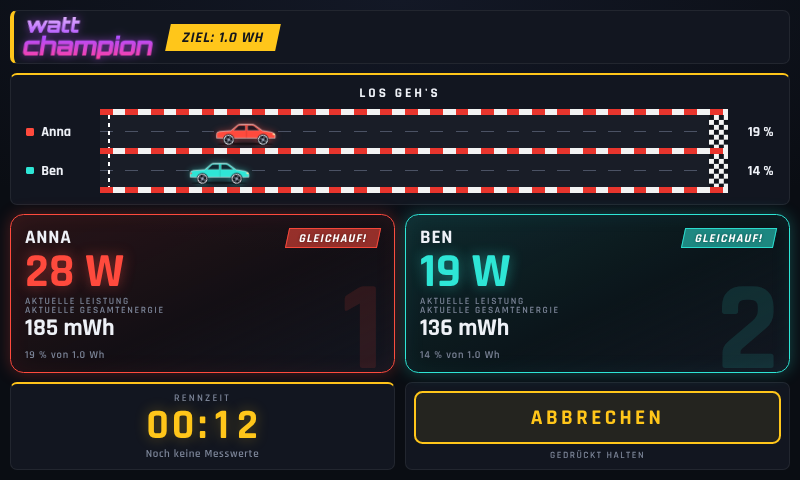
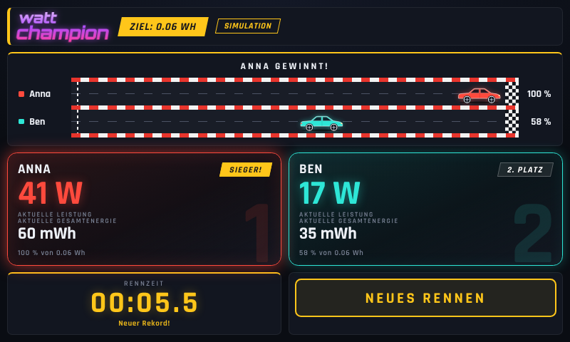

# watt champion – Rennoberfläche für den Raspberry Pi

Zwei Spieler erzeugen Strom (Handkurbel, Fahrrad-Generator …), und wer **zuerst die Zielenergie
(Standard: 1,0 Wh)** erreicht, gewinnt. Die Oberfläche zeigt live Leistung (W), Gesamtenergie (mWh),
Fortschritt, Rennstrecke mit Autos, Rennzeit und den Rekord.

| Rennen läuft | Ziel erreicht |
| --- | --- |
|  |  |

Die Oberfläche ist eine Webseite, die im Vollbild-Browser des Pi läuft (Kiosk-Modus). Ein kleiner
Python-Server liest die Sensoren, rechnet Leistung zu Energie auf und liefert die Seite aus.
**Es werden keine Python-Pakete benötigt** (nur die Standardbibliothek, Python ≥ 3.9); nur für
INA219-Sensoren zusätzlich `smbus2`. Alle Schriften liegen lokal – der Pi braucht kein Internet.

## Schnellstart (ohne Sensoren, Simulation)

```bash
cd watt-champion
python3 server.py
```

Dann `http://127.0.0.1:8080/` im Browser öffnen. Standardmäßig läuft eine **Simulation** (in der
Kopfzeile steht dann „Simulation“), damit sich alles ohne Hardware ausprobieren lässt.

**Bedienung:** *Start* startet nach einem 3-Sekunden-Countdown. Während des Rennens muss
*Abbrechen* eine Sekunde **gehalten** werden (damit niemand das Rennen versehentlich beendet).
Nach dem Ziel startet *Neues Rennen* zurück in den Bereitschaftszustand.
Tastatur: `Leertaste`/`Enter` Start bzw. Neues Rennen, `R` sofort zurücksetzen, `F` Vollbild.

## Konfiguration (`config.json`)

| Schlüssel | Bedeutung | Standard |
| --- | --- | --- |
| `title` | Logo-Text (erstes Wort oben, Rest darunter) | `watt champion` |
| `host`, `port` | Adresse des Servers. `127.0.0.1` = nur der Pi selbst; `0.0.0.0` = im Netzwerk erreichbar | `127.0.0.1`, `8080` |
| `target_wh` | Zielenergie in Wh | `1.0` |
| `countdown_s` | Countdown vor dem Start in Sekunden (`0` = sofort) | `3` |
| `tie_threshold_pct` | Liegen die Spieler weniger als so viele Prozent des Ziels auseinander, steht „Gleichauf!“ | `10` |
| `sample_hz` | Messungen pro Sekunde | `10` |
| `results_file` | Rekordliste (JSON), relativ zur Konfigurationsdatei; `null` = nicht speichern | `data/results.json` |
| `sponsor_logo` | Bild oben rechts, z. B. `"img/sponsoren.png"` (Datei in `static/img/` ablegen) | – |
| `sensor` | Messwertquelle, siehe unten | `{"type": "sim"}` |
| `players` | 2 bis 4 Spieler: `id`, `name`, `color` (`red`, `cyan`, `green`, `magenta`, `orange`, `blue`) | Anna (rot), Ben (cyan) |

Rekorde gelten je Zielenergie; wer `target_wh` ändert, startet eine neue Rekordliste.
Fehlerhafte Konfigurationen werden beim Start mit einer verständlichen Meldung abgelehnt.

## Sensoren

### `sim` – Simulation
Zufällige, aber glaubhafte Leistungskurven mit wechselnder Führung. Pro Spieler `"sim_w"` (mittlere
Leistung in W), im `sensor`-Block optional `"seed"` für reproduzierbare Läufe.

### `ina219` – INA219-Strom-/Spannungssensor am I²C-Bus
Pro Spieler ein INA219-Modul (z. B. die üblichen Breakout-Boards mit 0,1-Ω-Shunt). Beispiel:
[`config.ina219.example.json`](config.ina219.example.json).

1. I²C aktivieren: `sudo raspi-config` → *Interface Options* → *I2C*.
2. Jedes Modul braucht eine eigene Adresse (Lötbrücken A0/A1: `0x40`, `0x41`, `0x44`, `0x45`);
   prüfen mit `i2cdetect -y 1` (`sudo apt install i2c-tools`).
3. Modul mit dem Shunt (`VIN+` → `VIN−`) **in Reihe** zwischen Generator und Last schalten,
   `VCC`/`GND`/`SDA`/`SCL` an den Pi.
4. `smbus2` installieren (unter Raspberry Pi OS Bookworm in einer virtuellen Umgebung):
   ```bash
   python3 -m venv .venv && .venv/bin/pip install smbus2
   .venv/bin/python server.py --config config.ina219.example.json
   ```

Die Leistung ist `P = U_bus · I`, der Strom wird aus dem Spannungsabfall am Shunt berechnet
(`I = U_shunt / shunt_ohm`). Mit 0,1 Ω ist der Messbereich ±3,2 A (±320 mV), die Busspannung darf bis
26 V betragen – **bitte prüfen Sie, dass Ihr Aufbau innerhalb dieser Grenzen bleibt**. Für größere
Ströme einen kleineren Shunt einbauen und `shunt_ohm` anpassen. Fließt der Strom bei Ihnen
andersherum, setzen Sie beim Spieler `"invert": true`. Negative Leistung zählt als 0 W; fällt ein
Sensor aus, zeigt die Karte „–“ und das Rennen läuft für den anderen weiter.

### `push` – Messwerte von einem anderen Gerät
Ein ESP32, Arduino oder Skript schickt die aktuelle Leistung in Watt an den Server:

```bash
curl -X POST http://<pi>:8080/api/measurement \
     -H 'Content-Type: application/json' -d '{"anna": 28.4, "ben": 19.1}'
```

Mindestens alle ~2 s senden (`timeout_s`); ältere Werte gelten als „kein Messwert“. Dafür `host` auf
`0.0.0.0` setzen ([`config.push.example.json`](config.push.example.json)). **Achtung:** Die API hat
keine Authentifizierung – im Netzwerk kann dann jeder Rennen starten und Werte senden. Nur in einem
vertrauenswürdigen Netz betreiben.

Eine eigene Messquelle ist leicht ergänzt: eine Klasse mit `read()` → `{spieler_id: watt | None}` in
[`wattchamp/sensors.py`](wattchamp/sensors.py) und ein Eintrag in `make_sensor`.

## Auf dem Raspberry Pi einrichten

```bash
git clone <dieses Repository> ~/hololens-instruct
cd ~/hololens-instruct/watt-champion
cp config.ina219.example.json config.json     # oder config.json für die Simulation belassen

# Server als Dienst (User= und Pfade in der Datei vorher anpassen)
sudo cp deploy/watt-champion.service /etc/systemd/system/
sudo systemctl daemon-reload && sudo systemctl enable --now watt-champion
```

**Vollbild-Kiosk:** [`deploy/kiosk.sh`](deploy/kiosk.sh) startet Chromium im Kiosk-Modus, sobald der
Server antwortet. Wie man es beim Anmelden automatisch startet, hängt von der Raspberry-Pi-OS-Version ab:

* Wayland (labwc): Zeile `/home/pi/hololens-instruct/watt-champion/deploy/kiosk.sh &` in
  `~/.config/labwc/autostart`
* X11 (LXDE): Zeile `@/home/pi/hololens-instruct/watt-champion/deploy/kiosk.sh` in
  `~/.config/lxsession/LXDE-pi/autostart`

Damit der Bildschirm nicht ausgeht: `sudo raspi-config` → *Display Options* → *Screen Blanking* aus.
Die Oberfläche skaliert mit der Bildschirmgröße (getestet im Browser mit 480×365 bis 1920×1080,
Quer- und Hochformat; z. B. 800×480 beim offiziellen 7"-Touch-Display).

## HTTP-API

| Aufruf | Zweck |
| --- | --- |
| `GET /api/state` | kompletter Zustand (Status, Zeit, Spieler, Rekord) |
| `POST /api/start` | Rennen starten (`409`, wenn schon eines läuft) |
| `POST /api/reset` | Rennen abbrechen bzw. Ergebnis wegräumen |
| `POST /api/measurement` | nur mit Sensor `push`: `{"<id>": watt, …}` |

## Aufbau und Tests

```
server.py            Start (Argumente: --config, --host, --port)
wattchamp/race.py    Rennlogik: Leistung → Energie, Sieger, Rekord, Status je Spieler
wattchamp/sensors.py Messquellen sim / ina219 / push
wattchamp/results.py Rekordliste (JSON, atomar geschrieben)
wattchamp/web.py     HTTP-Server und API
static/              Oberfläche (index.html, style.css, app.js, Schriften)
deploy/              systemd-Dienst und Kiosk-Skript
```

```bash
python3 -m unittest discover -s tests -t .
```

Die Tests decken Rennlogik (inkl. exakter Zielzeit zwischen zwei Messungen), Rekorde, Konfiguration,
HTTP-API und den INA219-Treiber gegen einen **simulierten** I²C-Bus ab. Der INA219-Treiber und der
Kiosk-Start wurden noch nicht an echter Pi-Hardware ausprobiert; bitte beim ersten Aufbau
(Beispielwerte mit einem Netzteil/Multimeter gegenprüfen) kurz verifizieren.

## Lizenzen

Die Schriften Rajdhani und Orbitron stehen unter der SIL Open Font License
(`static/fonts/OFL-*.txt`) und sind auf Latin-Zeichen reduziert eingebunden.
